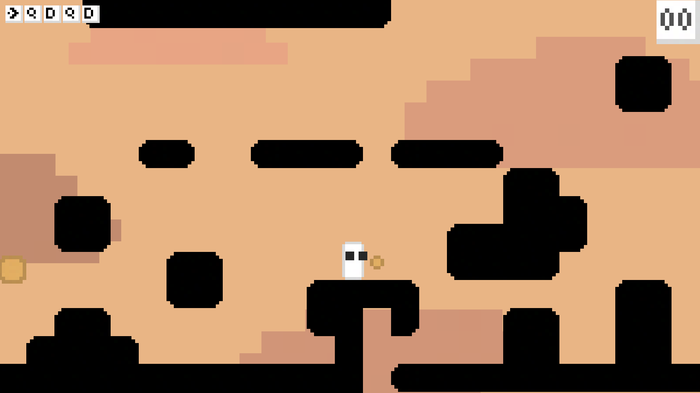

# keyDown

keyDown is a simple 2D platformer game for the GMTK GAME JAM.

## why I made it
I built it for the GMTK GAME JAM (2026), With the "count down" theme, I produced this small 2D platformer in pixel art on `Godot`. My approach was to make a counter of the keys used by level; I also implemented a global leaderboard to have some competition.

## how to play
link of the game on itch.io :
https://flowty00.itch.io/keydown
##